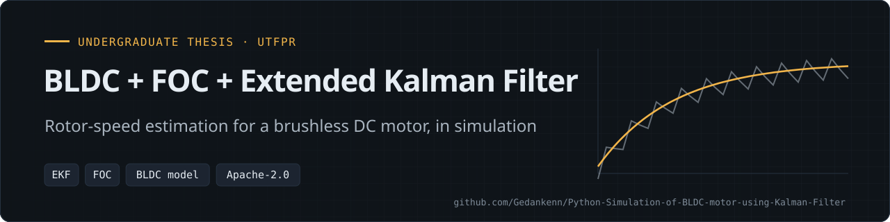

  
  
  
  

**Simulation of a brushless DC motor using Field-Oriented Control and an Extended Kalman Filter** as the estimation method for the rotor velocity. Undergraduate thesis (TCC) in Computer Engineering at UTFPR.

> **Status: complete (thesis).** This repository holds the write-up and the results; the simulation source code itself is not included here.

📄 **Thesis (in Portuguese):** [Modelagem e Controle de Motor sem escovas utilizando Filtro Estendido de Kalman](Modelagem%20e%20Controle%20de%20Motor%20sem%20escovas%20utilizando%20Filtro%20Estendido%20de%20Kalman.pdf) · also in the [UTFPR repository](https://repositorio.utfpr.edu.br/jspui/handle/1/29127)

Related: [ESP32-FOC](https://github.com/Gedankenn/ESP32-FOC) (firmware) · [OTPC](https://github.com/Gedankenn/OTPC) (PMSM traction controller)

---

## Overview

The motor is modeled in the phase (abc) frame with the rotor speed and electrical angle as states. The model is linearized locally to build the Extended Kalman Filter, which estimates rotor speed and position from the measured phase currents. The full discussion is in the thesis PDF.

## Architecture

| Path | Content |
|------|---------|
| `Modelagem e Controle de Motor sem escovas utilizando Filtro Estendido de Kalman.pdf` | Full thesis (in Portuguese) |
| `Resultados/kalman_fig_1.pdf` … `kalman_fig_5.pdf` | Simulation result figures |
| `Resultados/erro_total.pdf` | Total estimation error |

## Results

The result figures are in the [`Resultados`](Resultados) folder (PDF):

| Figure | File |
|---|---|
| Kalman results 1–5 | [fig 1](Resultados/kalman_fig_1.pdf) · [fig 2](Resultados/kalman_fig_2.pdf) · [fig 3](Resultados/kalman_fig_3.pdf) · [fig 4](Resultados/kalman_fig_4.pdf) · [fig 5](Resultados/kalman_fig_5.pdf) |
| Total estimation error | [erro_total.pdf](Resultados/erro_total.pdf) |

The complete discussion of the results is in the thesis PDF at the root of the repository.

## Theory

### State-space model of the BLDC motor

$$
\frac{d}{dt}x = Fx+Gu\\
y=Hx
$$

$$
\frac{d}{dt}
\left(\begin{array}{c}
I_a\\
I_b \\
I_c \\
\omega_r \\
\theta_e
\end{array}\right)
= \left(\begin{array}{ccccc}
-\frac{R}{L-M} & 0 & 0 & -\frac{P_p\phi_mF_a(\theta_e)}{L-M} & 0\\
0 & -\frac{R}{L-M} & 0 & -\frac{P_p\phi_mF_b(\theta_e)}{L-M} & 0\\
0 & 0 & -\frac{R}{L-M} & -\frac{P_p\phi_mF_c(\theta_e)}{L-M} & 0\\
\frac{P_p\phi_mF_A(\theta_e)}{J} & \frac{P_p\phi_mF_B(\theta_e)}{J} & \frac{P_p\phi_mF_C(\theta_e)}{J} & -\frac{B}{J} & 0 \\
0 & 0 & 0 & P_p & 0
\end{array}\right)
\left(\begin{array}{c}
I_a \\
I_b \\
I_c \\
\omega_r \\
\theta_e
\end{array}\right)
+
\left(\begin{array}{cccc}
\frac{1}{L-M} & 0 & 0 & 0\\
0 & \frac{1}{L-M} & 0 & 0\\
0 & 0 & \frac{1}{L-M} & 0\\
0 & 0 & 0 & -\frac{1}{J} \\
0 & 0 & 0 & 0
\end{array}\right)
\left(\begin{array}{c}
V_an \\
V_bn \\
V_cn \\
T_c
\end{array}\right)
$$

$$
\left(\begin{array}{c}
I_a \\
I_b \\
I_c
\end{array}\right)
= \left(\begin{array}{ccccc}
1 & 0 & 0 & 0 & 0\\
0 & 1 & 0 & 0 & 0\\
0 & 0 & 1 & 0 & 0
\end{array}\right)
\left(\begin{array}{c}
I_a \\
I_b \\
I_c \\
\omega_r \\
\theta_e
\end{array}\right)
$$

$$
\dot{x} = f(x,t) + v(t)
$$

$$
dF(x,t) = \left(\begin{array}{ccccc}
\frac{\partial f_1}{\partial i_a} \frac{\partial f_1}{\partial i_b} \frac{\partial f_1}{\partial i_c} \frac{\partial f_1}{\partial \omega_r} \frac{\partial f_1}{\partial \theta_e} \\
\frac{\partial f_2}{\partial i_a} \frac{\partial f_2}{\partial i_b} \frac{\partial f_2}{\partial i_c} \frac{\partial f_2}{\partial \omega_r} \frac{\partial f_2}{\partial \theta_e} \\
\frac{\partial f_3}{\partial i_a} \frac{\partial f_3}{\partial i_b} \frac{\partial f_3}{\partial i_c} \frac{\partial f_3}{\partial \omega_r} \frac{\partial f_3}{\partial \theta_e} \\
\frac{\partial f_4}{\partial i_a} \frac{\partial f_4}{\partial i_b} \frac{\partial f_4}{\partial i_c} \frac{\partial f_4}{\partial \omega_r} \frac{\partial f_4}{\partial \theta_e} \\
\frac{\partial f_5}{\partial i_a} \frac{\partial f_5}{\partial i_b} \frac{\partial f_5}{\partial i_c} \frac{\partial f_5}{\partial \omega_r} \frac{\partial f_5}{\partial \theta_e}
\end{array}\right)
$$

$$\begin{array}{ccccc}
f_1 &= \frac{1}{L_M}V_{An} -\frac{R}{L_M}i_a -\frac{P_p\phi_mf_A(\theta_e)}{L_M}\omega_m \\
f_2 &= \frac{1}{L_M}V_{An} -\frac{R}{L_M}i_b -\frac{P_p\phi_mf_B(\theta_e)}{L_M}\omega_m \\
f_3 &= \frac{1}{L_M}V_{An} -\frac{R}{L_M}i_c -\frac{P_p\phi_mf_C(\theta_e)}{L_M}\omega_m \\
f_4 &= \frac{P_p\phi_m}{J}(i_af_A(\theta_e)+i_bf_B(\theta_e)+i_cf_C(\theta_e))-\frac{1}{J}(B_v\omega_m+T_c) \\
f_5 &= P_p\omega_m
\end{array}
$$

Applying local linearization, we obtain the model we will use for the Extended Kalman Filter.

$$
dF(x,t) =
\left(\begin{array}{ccccc}
-\frac{R}{L-M} & 0 & 0 & -\frac{P_p\phi_mF_a(\theta_e)}{L-M} & -\frac{P_p\phi_m\omega_r}{L-M}\frac{dF_a(theta_e)}{d\theta_e}\\
0 & -\frac{R}{L-M} & 0 & -\frac{P_p\phi_mF_b(\theta_e)}{L-M} & -\frac{P_p\phi_m\omega_r}{L-M}\frac{dF_b(theta_e)}{d\theta_e}\\
0 & 0 & -\frac{R}{L-M} & -\frac{P_p\phi_mF_c(\theta_e)}{L-M} & -\frac{P_p\phi_m\omega_r}{L-M}\frac{dF_c(theta_e)}{d\theta_e}\\
\frac{P_p\phi_mF_a(\theta_e)}{J} & \frac{P_p\phi_mF_b(\theta_e)}{J} & \frac{P_p\phi_mF_c(\theta_e)}{J} & -\frac{B}{J} &
\frac{P_p\phi_m}{J}(\frac{dF_a(\theta_e)}{d\theta_e}i_a + \frac{dF_b(\theta_e)}{d\theta_e}i_b + \frac{dF_c(\theta_e)}{d\theta_e}i_c) \\
0 & 0 & 0 & P_p & 0
\end{array}\right)
$$

### Discretization of dF

$$
dF_d = I + dF.Ts + \frac{dF^2}{2!}Ts
$$

### Extended Kalman Filter equations

$$
\hat{x}_{k|k+1} = F\hat{x}_{k|k} + Gu_k + \omega_k
$$

where:

* $\hat{x}_{k|k+1}$ is the sistem state vector
* F is the state transition matrix
* G is the control matrix
* $u_k$ is control vector
* $\omega_k$ is the process noise

The covariation matrix for the k|k+1 state is calculated as:

$$
P_{k|k+1} =dFP_{k|k}dF^T+Q
$$

where:

* $Q$ is the noise process covariance matrix

$$
\hat{y}_{k|k} = H\hat{x}_{k|k} + v_n
$$

where:

* $\hat{y}{k|k}$ is the measurement vector from the model
* $H$ is the observation matrix
* $v_n$ is the measurement noise

$$\tilde{y}_k = y_k - \hat{y}_{k|k}$$
$$ K_k = P_{k|k-1}H^T(HP_{k|k-1}H^T+R_n)^{-1}$$
$$ \hat{x}_{k|k} = \hat{x}_{k|k-1}+K_k\tilde{y}_k$$
$$ P_{k|k} = (I -K_kH)P_{k|k-1}$$

## References

The work is based on:

* XIA, C. L. Permanent Magnet Brushless DC Motor Drives and Controls. [S. l.: s. n.], 2012.
ISBN 9781118188330. DOI: 10.1002/9781118188347.
* XIA, K. et al. Model predictive control method of torque ripple reduction for BLDC Motor.
IEEE Transactions on Magnetics, v. 56, n. 1, p. 1–6, 2020. ISSN 19410069. DOI:
10.1109/TMAG.2019.2950953.

* O’ROURKE, C. J. et al. A Geometric Interpretation of Reference Frames and Transformations:
Dq0, Clarke, and Park. IEEE Transactions on Energy Conversion, v. 34, n. 4, p. 2070–2083,2019. ISSN 15580059. DOI: 10.1109/TEC.2019.2941175.
* SCHMITZ, C. Projeto E Otimização De Motores Bldc De Imãs Permanentes Superficiais.
Dissertação de Mestrado, UFSC, 2017.
* TERZIC, B.; JADRIC, M. Design and implementation of the extended Kalman filter for the
speed and rotor position estimation of brushless dc motor. IEEE Transactions on Industrial
Electronics, IEEE, v. 48, n. 6, p. 1065–1073, 2001. ISSN 02780046. DOI:
10.1109/41.969385.

* LIU, Y.; ZHU, Z. Q.; HOWE, D. Instantaneous torque estimation in sensorless
direct-torque-controlled brushless DC motors. IEEE Transactions on Industry Applications,
v. 42, n. 5, p. 1275–1283, 2006. ISSN 00939994. DOI: 10.1109/TIA.2006.880854

## License

Apache License 2.0, see [LICENSE](LICENSE).

---
Part of <a href="https://github.com/Gedankenn">Fabio Slika Stella's</a> embedded work · <a href="https://gedankenn.github.io/Gedankenn/">portfolio</a>
